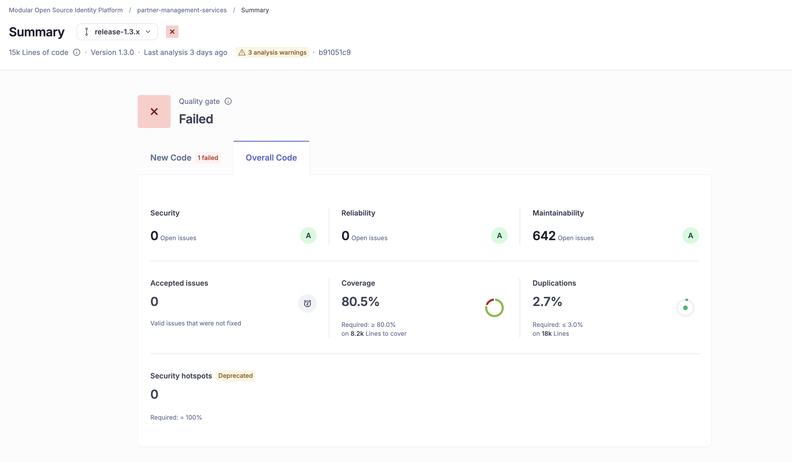
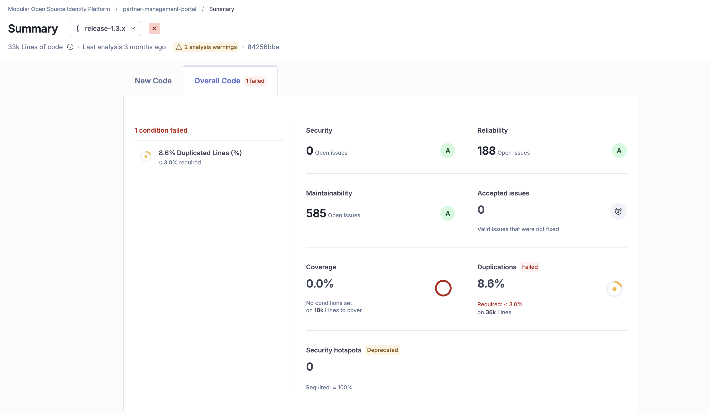

# Test Report

## 1. Introduction

The Partner Management System Revamp testing scope includes the following features: MISP Partner, ABIS Partner, Authentication Partner, Device Partner, FTM Partner, Credential Partner, Manual Adjudication Partner, Online Verification Partner, Partner Admin, Certificate Trust Store, Partners, Policies, Partner-Policy Linking, SBI-Device, FTM Chip, Authentication Services, User Profile, User Dashboard, Root CA Certificate expiry notifications, Intermediate Certificate expiry notifications, Partner Certificate expiry notifications, API Key expiry notifications, FTM Chip expiry notifications, SBI ID expiry notifications, and Weekly Summary notifications for Partner Certificate, API Key, FTM Chip, and SBI ID expiry.

### 1.1 Overview and Scope

The scope of testing defines the boundaries, functionalities, and features that will be tested for the Partner Management System (PMS) Revamp. This ensures comprehensive validation of critical workflows while clearly identifying what is included and excluded from testing.

**Functional Features:** MISP Partner, ABIS Partner, Authentication Partner, Device Partner, FTM Partner, Credential Partner, Manual Adjudication Partner, Online Verification Partner, Partner Admin, Certificate Trust Store, Partners, Policies, Partner-Policy Linking, SBI-Device Mapping, FTM Chip, Authentication Services, User Profile, User Dashboard.

As part of PMS compatibility testing, both eSignet v1.6.2 and v1.8.0 were successfully tested with PMS.

**Cross-Platform Support:**

* Multilingual: English, Arabic, French
* Multi-Browser: Edge, Firefox, Chrome
* Devices: Windows, Mac, Tablet, Extra-large screens
* Testing Types: Sanity, Regression Testing and Integration Testing
* Cross-browser and cross-device compatibility testing

## 2. Test Approach

The scope of testing is to verify fitment to the specification from the perspective of:

* Functionality
* Combination
* UI Automation
* API automation
* Library verification

## 3. Test Organization

| Name                 | Functional Role | Responsibilities                                                                                                                                                                                      |
| -------------------- | --------------- | ----------------------------------------------------------------------------------------------------------------------------------------------------------------------------------------------------- |
| Ragini Krishnamurthy | Manager         | Defining test strategy, managing QA activities, and ensuring overall product quality.                                                                                                                 |
| Prathmesh Jadhav     | Lead            | Leading the test team, planning and executing tests, and ensuring timely delivery of quality results.                                                                                                 |
| Swetha N             | QA Engineer     | Designing and executing test cases, performing functional and regression testing, verifying PMS module functionality, logging and tracking defects, and validating fixes to ensure quality standards. |

### 3.1 Test Planning

This Test Plan outlines the testing approach, scope, resources, and schedule for the Partner Management System (PMS) Revamp. The objective is to ensure that all functional, integration, and non-functional requirements are met with high quality before release.

* Validate end-to-end functionality of the Partner Management System Revamp.
* Ensure system stability across supported browsers, devices, and languages.
* Verify integrations with dependent systems and services.
* Identify and mitigate risks early through regression and integration testing.

### 3.2 Sanity Scenarios Verified

Sanity testing is performed to ensure basic application stability before detailed test execution. The following high-level sanity scenarios were verified:

* Application accessibility and successful login for different partner roles.
* Core partner creation and management flows (MISP, Device, Auth, Credential, FTM, ABIS and Online Verification Partner).
* Partner Admin workflows E2E.
* MISP Partner: Creating and managing MISP partners and MISP license key creation.
* Device Partner: Creating and managing device partners.
* Auth Partner: Creating and managing Auth partners by creating auth policies, OIDC client ID and API Key.
* Credential Partner: Creating and managing Credential partners and credential type creation.
* FTM Partner: Creating and managing FTM partners, including FTM chip creation and configuration.
* ABIS Partner: Creating and managing ABIS partners.
* Online Verification Partner: Creating and managing Online Verification partners, including policy and credential type creation and configuration.

Only upon successful completion of sanity testing will the build be accepted for full regression and integration testing.

As part of PMS compatibility testing, both eSignet v1.6.2 and v1.8.0 were successfully tested with PMS.

### 3.3 Test Environment

Environment: <mark style="color:$primary;">https://qaj21.mosip.net</mark>

| Image                                                                           |
| ------------------------------------------------------------------------------- |
| docker.io/mosipdev/activemq-artemis:2.39.0                                      |
| docker.io/mosipdev/alpine:latest                                                |
| docker.io/mosipid/admin-service:1.3.1                                           |
| docker.io/mosipid/admin-ui:1.3.0                                                |
| docker.io/mosipid/apitest-auth:1.3.1                                            |
| docker.io/mosipid/apitest-idrepo:1.3.1                                          |
| docker.io/mosipid/apitest-masterdata:1.3.1                                      |
| docker.io/mosipqa/apitest-pms:1.3.x                                             |
| docker.io/mosipid/apitest-prereg:1.3.0                                          |
| docker.io/mosipid/apitest-resident:1.3.2                                        |
| docker.io/mosipid/artifactory-server:1.2.0.2                                    |
| docker.io/mosipid/artifactory-server:1.3.2                                      |
| docker.io/mosipid/authentication-internal-service:1.3.1                         |
| docker.io/mosipid/authentication-otp-service:1.3.1                              |
| docker.io/mosipid/authentication-service:1.3.1                                  |
| docker.io/mosipid/biosdk-server:1.3.1                                           |
| docker.io/mosipid/captcha-validation-service:0.1.1                              |
| docker.io/mosipid/clamav:1.3.0\_base                                            |
| docker.io/mosipid/commons-packet-service:1.3.1                                  |
| docker.io/mosipid/consolidator-websub-service:1.3.2                             |
| docker.io/mosipid/data-share-service:1.3.1                                      |
| docker.io/mosipid/digital-card-service:1.3.0                                    |
| docker.io/mosipid/dsl-orchestrator:1.5.0                                        |
| docker.io/mosipid/dsl-packetcreator:1.5.0                                       |
| docker.io/mosipid/esignet-with-plugins:1.6.2                                    |
| docker.io/mosipid/esignet-with-plugins:1.8.0                                    |
| docker.io/mosipid/esignet:1.4.1                                                 |
| docker.io/mosipid/hotlist-service:1.3.1                                         |
| docker.io/mosipid/id-repository-salt-generator:1.3.1                            |
| docker.io/mosipid/kafka:3.2.1-debian-11-r9                                      |
| docker.io/mosipid/kernel-auditmanager-service:1.3.2                             |
| docker.io/mosipid/kernel-auth-service:1.3.1                                     |
| docker.io/mosipid/kernel-config-server:1.3.1                                    |
| docker.io/mosipid/kernel-idgenerator-service:1.3.1                              |
| docker.io/mosipid/kernel-keymanager-service:1.4.1                               |
| docker.io/mosipid/kernel-masterdata-service:1.3.1                               |
| docker.io/mosipid/kernel-notification-service:1.3.1                             |
| docker.io/mosipid/kernel-otpmanager-service:1.3.0                               |
| docker.io/mosipid/kernel-pridgenerator-service:1.3.1                            |
| docker.io/mosipid/kernel-ridgenerator-service:1.3.1                             |
| docker.io/mosipid/kernel-salt-generator:1.3.1                                   |
| docker.io/mosipid/kernel-syncdata-service:1.3.1                                 |
| docker.io/mosipid/keycloak-init:1.2.0.2                                         |
| docker.io/mosipid/keycloak-init:1.3.0                                           |
| docker.io/mosipid/keys-generator:1.4.1                                          |
| docker.io/mosipid/masterdata-loader:1.3.0                                       |
| docker.io/mosipid/minio-client-util                                             |
| docker.io/mosipid/minio-client-util:latest                                      |
| docker.io/mosipid/minio:2025.2.28-debian-12-r1                                  |
| docker.io/mosipid/mock-abis:1.3.1                                               |
| docker.io/mosipid/mock-mv:1.3.1                                                 |
| docker.io/mosipid/mock-relying-party-service:0.11.2                             |
| docker.io/mosipid/mock-relying-party-service:0.13.0                             |
| docker.io/mosipid/mock-relying-party-service:0.9.3                              |
| docker.io/mosipid/mock-relying-party-ui:0.11.2                                  |
| docker.io/mosipid/mock-relying-party-ui:0.13.0                                  |
| docker.io/mosipid/mock-relying-party-ui:0.9.3                                   |
| docker.io/mosipid/mock-smtp:1.0.0                                               |
| docker.io/mosipid/mosip-artemis-keycloak:1.3.0                                  |
| docker.io/mosipid/mosip-file-server:1.3.0                                       |
| docker.io/mosipid/oidc-ui:1.4.1                                                 |
| docker.io/mosipid/oidc-ui:1.6.2                                                 |
| docker.io/mosipid/oidc-ui:1.8.0                                                 |
| docker.io/mosipid/partner-management-service:1.3.0                              |
| docker.io/mosipid/partner-onboarder:1.2.0.1                                     |
| docker.io/mosipid/partner-onboarder:1.3.1                                       |
| docker.io/mosipid/pmp-ui-v2:1.3.0                                               |
| docker.io/mosipid/policy-management-service:1.3.0                               |
| docker.io/mosipid/postgres-init:1.2.0.1                                         |
| docker.io/mosipid/postgres-init:1.3.0                                           |
| docker.io/mosipid/pre-registration-application-service:1.3.0                    |
| docker.io/mosipid/pre-registration-batchjob:1.3.0                               |
| docker.io/mosipid/pre-registration-booking-service:1.3.1                        |
| docker.io/mosipid/pre-registration-datasync-service:1.3.0                       |
| docker.io/mosipid/pre-registration-ui:1.3.0                                     |
| docker.io/mosipid/print:1.3.1                                                   |
| docker.io/mosipid/redis:7.0.5-debian-11-r25                                     |
| docker.io/mosipid/regclient-keystore:1.0.0                                      |
| docker.io/mosipid/registration-processor-common-camel-bridge:1.3.1              |
| docker.io/mosipid/registration-processor-dmz-packet-server:1.3.1                |
| docker.io/mosipid/registration-processor-landing-zone:1.3.1                     |
| docker.io/mosipid/registration-processor-notification-service:1.3.1             |
| docker.io/mosipid/registration-processor-registration-status-service:1.3.1      |
| docker.io/mosipid/registration-processor-registration-transaction-service:1.3.1 |
| docker.io/mosipid/registration-processor-reprocessor:1.3.1                      |
| docker.io/mosipid/registration-processor-stage-group-1:1.3.1                    |
| docker.io/mosipid/registration-processor-stage-group-2:1.3.1                    |
| docker.io/mosipid/registration-processor-stage-group-3:1.3.1                    |
| docker.io/mosipid/registration-processor-stage-group-4:1.3.1                    |
| docker.io/mosipid/registration-processor-stage-group-5:1.3.1                    |
| docker.io/mosipid/registration-processor-stage-group-6:1.3.1                    |
| docker.io/mosipid/registration-processor-stage-group-7:1.3.1                    |
| docker.io/mosipid/registration-processor-workflow-manager-service:1.3.1         |
| docker.io/mosipid/resident-service:1.3.0                                        |
| docker.io/mosipid/resident-ui:0.9.1                                             |
| docker.io/mosipid/softhsm:v2                                                    |
| docker.io/mosipid/uitest-pmp-v2:1.3.0                                           |
| docker.io/mosipid/websub-service:1.3.2                                          |
| docker.io/mosipid/zookeeper:3.8.0-debian-11-r30                                 |
| docker.io/mosipqa/credential-request-generator:1.3.x                            |
| docker.io/mosipqa/credential-service:1.3.x                                      |
| docker.io/mosipqa/id-repository-identity-service:1.3.x                          |
| docker.io/mosipqa/id-repository-vid-service:1.3.x                               |
| docker.io/mosipqa/registration-client:1.2.0.x                                   |
| mosipid/apitest-auth:1.3.1                                                      |
| mosipid/apitest-idrepo:1.3.1                                                    |
| mosipid/apitest-masterdata:1.3.1                                                |
| mosipqa/apitest-pms:1.3.x                                                       |
| mosipid/apitest-prereg:1.3.0                                                    |
| mosipid/apitest-resident:1.3.2                                                  |
| mosipid/clamav:1.3.0\_base                                                      |
| mosipid/kernel-config-server:1.3.1                                              |
| mosipid/keycloak-init:1.2.0.2                                                   |
| mosipid/keycloak-init:1.3.0                                                     |
| mosipid/masterdata-loader:1.3.0                                                 |
| mosipid/postgres-init:1.2.0.1                                                   |
| mosipid/postgres-init:1.3.0                                                     |
| mosipid/regclient-keystore:1.0.0                                                |
| mosipid/softhsm:v2                                                              |

## 4. Test Execution Report

Below are the test metrics from functional testing. The process followed was black box testing, which bases its test cases on the specifications of the software component under test. The functional test was performed in combination with individual module testing as well as integration testing. Test data were prepared in line with the user stories. Expected results were monitored by examining the user interface. The coverage includes GUI testing, System testing, and End-To-End flows across multiple languages and configurations.

### 4.1 Test Case Execution Summary

The Test Case Execution Summary provides an overview of the total test cases executed across platforms, including pass, fail, and skip counts, with observations on execution pass rates.

**Test Case - Manual Verification (UI)**

| Total | Passed | Failed | Skipped (N/A) |
| ----- | ------ | ------ | ------------- |
| 8332  | 8310   | 10     | 12            |

Test Rate: 100% with Pass Rate: 99%


12 test cases are marked N/A because they are descoped scenarios or features that are not developed.


**Test Case - Manual Verification (API)**

| Total | Passed | Failed | Skipped (N/A) |
| ----- | ------ | ------ | ------------- |
| 1548  | 1548   | 0      | 0             |

Test Rate: 100% with Pass Rate: 100%

### 4.2 Automation Results

This section summarizes the automated test execution, showing the pass, fail, and known issue counts from the automated test suite.

**Automation Execution Result - API Testrig**

| Total | Passed | Failed | Skipped (N/A) | Ignored | Known issues |
| ----- | ------ | ------ | ------------- | ------- | ------------ |
| 1955  | 1949   | 0      | 0             | 0       | 6            |

Test Rate: 100% with Pass Rate: 100%


API flow is tested through automation for both positive and negative scenarios, while test cases that are not automated are tested manually.


**Automation Execution Result - UI Automation**

| Total | Passed | Failed | Skipped (N/A) | Ignored | Known issues |
| ----- | ------ | ------ | ------------- | ------- | ------------ |
| 182   | 182    | 0      | 0             | 0       | 0            |

Test Rate: 100% with Pass Rate: 100%

As part of PMS compatibility testing, both eSignet v1.6.2 and v1.8.0 were successfully tested with PMS.

### 4.3 Detailed Test Metrics

Below are the detailed test metrics from manual and automation testing. The project metrics are derived from defect density, test coverage, test execution coverage, test tracking, and efficiency.

The metrics that assist in test tracking and efficiency are:

* **Passed Test Cases Coverage:** The percentage of passed test cases. (Number of passed tests / Total number of tests executed) x 100
* **Failed Test Case Coverage:** The percentage of failed test cases. (Number of failed tests / Total number of test cases executed) x 100

## 5. Test Configurations

Verification is performed on the configurations below:

* Default configuration with verified configuration for 3 languages (English/Arabic/French)

### 5.1 Browser Compatibility Evaluations

**Browser versions tested on desktop/laptop**

| Sl.No | Browser | Version        |
| ----- | ------- | -------------- |
| 1     | Chrome  | 147.0.7727.138 |
| 2     | Firefox | 147.0.2        |
| 3     | Edge    | 147.0.3912.98  |

**Browser versions tested on tablet device**

| Sl.No | Browser | Version        |
| ----- | ------- | -------------- |
| 1     | Chrome  | 148.0.7778.167 |
| 2     | Firefox | 150.0.3        |
| 3     | Edge    | 148.0.3967.55  |

**Browser versions tested on extra-large screens**

| Sl.No | Browser | Version        |
| ----- | ------- | -------------- |
| 1     | Chrome  | 146.0.7680.154 |
| 2     | Firefox | 148.0.3967.54  |
| 3     | Edge    | 148.0.3967.54  |
| 4     | Safari  | 21623.2.7.11.7 |

### 5.2 Screen Sizes Used for UI Responsiveness Validation

* Laptop/Desktop: 1920x1080
* Tablet: 1280x800
* Extra-large screens: 3840x2160
* MacBook: 2560x1664

## 6. Feature Health

<figure><figcaption></figcaption></figure>

## 7. Known Issues Metrics

This section covers issues that are known but not addressed in the current GA release.

**Defect Metrics for the known issues**

| Blocker | Critical | Major | Minor | Total |
| ------- | -------- | ----- | ----- | ----- |
| 0       | 0        | 22    | 13    | 35    |

## 8. Sonar Report

**Partner-Management-Service**

<figure><figcaption></figcaption></figure>

**Partner-Management-Portal**

<figure><figcaption></figcaption></figure>

## 9. Conclusion

The Partner Management System (PMS) Revamp GA Release has been successfully validated in the qajava21 environment, with all critical functionalities performing as expected.

Sanity, regression, and integration testing were completed within the defined scope.

* No critical or high-severity defects remain open.
* Based on the successful test execution and results, QA approves the build for release.

### 9.1 QA Approval

The build has met all the defined exit criteria and is recommended for release based on the following:

* **Test Case Execution:** All planned test cases have been executed successfully.
* **Story and Defect Closure:** All user stories are completed, and no critical or high-severity defects remain open.
* **Automation Reports:** API-Testrig and UI automation execution reports have been reviewed and approved.
* **Documentation Sign-off:** All required test and release documentation has been reviewed and signed off.
* **Test Environment Stability:** The test environment remained stable throughout the testing cycle.

**Report sign-off details**

| Name            | Functional Role | Responsibilities                                                                                      |
| --------------- | --------------- | ----------------------------------------------------------------------------------------------------- |
| Ragini Krishna  | Manager         | Defining test strategy, managing QA activities, and ensuring overall product quality.                 |
| Prathmesh Jadav | Lead            | Leading the test team, planning and executing tests, and ensuring timely delivery of quality results. |

## 10. Appendix

This section includes additional reference information: a history of document versions and a list of acronyms and their meanings.

### Appendix A: Versions

| Version | Date       | Author   | Reviewers      |
| ------- | ---------- | -------- | -------------- |
| 1.0     | 17/08/2026 | Swetha N | Ragini Krishna |

### Appendix B: Acronyms

| Acronym | Literal Translation                       |
| ------- | ----------------------------------------- |
| SBI     | Secure Biometric Interface                |
| FTM     | Foundational Trust Module                 |
| ABIS    | Automated Biometric Identification System |
