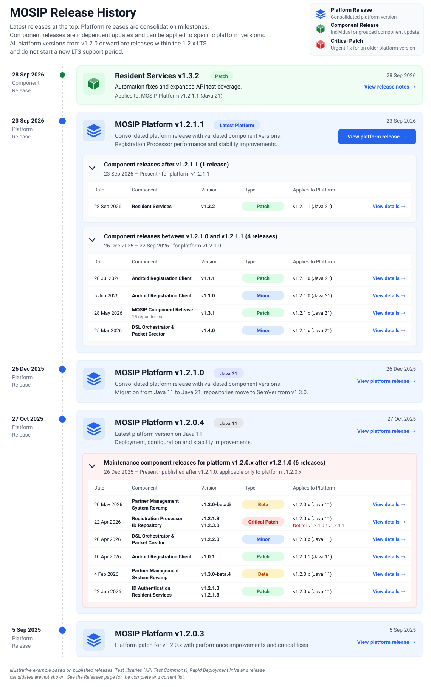

# MOSIP Versioning and Release Policy

## 1. Purpose

MOSIP publishes two types of releases: **platform releases** and **component releases**.

Platform releases provide a consolidated, validated baseline for countries and implementation partners that prioritize stability, predictable upgrades and a fully tested deployment path.

Component releases allow individual modules or coordinated groups of modules to evolve independently, enabling faster delivery of features, fixes and country-specific requirements without waiting for the next platform release.

This policy explains how MOSIP versions and names its software, how platform and component releases relate to each other, and how countries and implementers can choose the release that best suits their needs.

## 2. Understanding the MOSIP Release Model

### 2.1 Platform Releases

A platform release is a consolidated release of MOSIP that brings together compatible versions of its required components and associated deployment artifacts into a validated platform baseline.

Platform releases are typically published every six to twelve months, depending on the roadmap, feature readiness and release validation.

Each platform release provides:

* A defined set of component versions and deployment artifacts.
* A consolidated release baseline validated by the MOSIP QA team.
* A documented upgrade path from the preceding supported platform baseline, where applicable.
* Release notes, deployment instructions, compatibility information and database migration guidance.
* A stable reference point for countries planning to adopt or upgrade their MOSIP deployment.

Platform releases are the recommended choice for countries and implementers who prioritize stability and want to follow a consolidated, fully tested release.

**Example:** [v1.2.1.1](v1.2.1.1/) consolidates `registration` v1.3.1, `id-repository` v1.3.1, `id-authentication` v1.3.1, `keymanager` v1.4.1, `mosip-infra` v1.2.1.1 and other components into one validated baseline.

### 2.2 Component Releases

A component release is an independently published release of an individual MOSIP module or a coordinated group of related modules.

Component releases may be published whenever new features, bug fixes, security updates or country-specific requirements are ready for release. They do not have to coincide with a platform release.

Component releases allow individual repositories to evolve independently while retaining the existing platform baseline as the reference point for compatibility and testing.

Each component release must document, as applicable:

* The component name and version.
* New features, bug fixes and security updates.
* The platform version or versions to which the release applies.
* Dependencies on other components and any required coordinated upgrades.
* Database schema changes, migration scripts and upgrade instructions.
* Known limitations and compatibility considerations.

A component release does not automatically create a new platform release or change the component versions included in an already published platform release.

**Examples:**

* [Resident Services v1.3.2](resident-services-v1.3.2.md) — a single component.
* [MOSIP Component Release v1.3.1](mosip-component-release-v1.3.1.md) — a coordinated group of components released together.
* [Registration Processor 1.2.1.3 & ID Repository 1.2.3.0](registration-processor-1.2.1.3-and-id-repository-1.2.3.0/) — a group of components targeting an older platform version.

### 2.3 Relationship Between Platform and Component Releases

Platform releases and component releases serve different purposes and follow different release cadences.

A platform release establishes a consolidated baseline. Component releases published afterward may provide new capabilities or fixes for specific components without changing that baseline.

When a new platform release is published, it typically consolidates the component releases published for that platform version since the preceding platform release, after validating them together. In some cases, a component version may be held back or replaced by a later version, for example when it does not pass consolidated validation or when it targets an older platform version.

The published platform release documentation identifies the exact component versions included in that release.

## 3. MOSIP Versioning Conventions

MOSIP uses different versioning conventions for individual repositories and consolidated platform releases.

### 3.1 Component and Repository Versioning

Starting from version **1.3.0**, MOSIP repositories follow **Semantic Versioning 2.0.0 (SemVer)** for component-level releases. Version 1.3.0 of the repositories coincides with the migration of the MOSIP codebase from Java 11 to Java 21, delivered in platform release [v1.2.1.0](v1.2.1.0/).

Under SemVer, a version follows the format:

`MAJOR.MINOR.PATCH`

* **MAJOR:** Introduces changes that break REST API backward compatibility.
* **MINOR:** Introduces new functionality while keeping REST APIs backward compatible.
* **PATCH:** Introduces bug fixes while keeping REST APIs backward compatible.

Prerelease identifiers and build metadata follow the SemVer 2.0.0 specification, for example `1.3.0-beta.5`.

#### What backward compatibility means in MOSIP

MOSIP is a microservice-based application. Its services work with each other through REST APIs, and implementers and adopters build their own solutions on top of these REST APIs. In MOSIP, backward compatibility therefore refers to the **structure and behavior of the REST APIs** that a component exposes.

* **MINOR and PATCH releases** must keep the structure and behavior of existing REST APIs backward compatible, so that other MOSIP services and solutions built on these APIs continue to work without changes.
* **MAJOR releases** are required whenever a change breaks this compatibility.

For example, removing or renaming an endpoint or a field, changing a field's data type, making an optional field mandatory, or changing the behavior of an existing API breaks backward compatibility and requires a MAJOR version. Adding a new endpoint or a new optional field does not.

Public Java interfaces that implementers use to extend or integrate with MOSIP should likewise keep their structure and behavior unchanged in MINOR and PATCH releases.

Changes outside the REST APIs, such as database schema updates, configuration changes or a change of Java runtime, do not by themselves require a MAJOR version. When a release includes such changes, its release notes must describe them along with the required migration, configuration and upgrade steps. For example, the repositories moved from Java 11 to Java 21 in version 1.3.0, a MINOR version, because the REST APIs remained backward compatible.

Repository releases made before 1.3.0, and maintenance releases that continue to target the older Java 11 platform versions, use the earlier four-part format. For example, `id-repository` v1.2.3.0 and `registration` v1.2.1.3 are maintenance releases for platform v1.2.0.x, while `id-repository` v1.3.1 and `registration` v1.3.1 target platform v1.2.1.x.

**Exception for infrastructure repositories:** Infrastructure and deployment repositories, such as `mosip-infra` and `k8s-infra`, are generally released along with the platform and provide its deployment path. These repositories therefore retain the four-part platform-style version format. For example, platform release v1.2.1.1 includes `mosip-infra` v1.2.1.1 and `k8s-infra` v1.2.1.3.

Individual repository versions are maintained independently. Consequently, different components may have different version numbers and may release new versions at different times. For example, platform release v1.2.1.1 includes `keymanager` v1.4.1 alongside `registration` v1.3.1.

A component's version number must not be interpreted as the platform version or as proof that it is compatible with a particular platform baseline. Compatibility must be established through the release documentation.

### 3.2 Platform Versioning

MOSIP currently retains a four-part numeric versioning convention for platform releases, for example `1.2.1.1`.

This convention was retained to preserve continuity with the existing MOSIP 1.2.x platform versions. All platform versions from v1.2.0 onward (1.2.x), including v1.2.0.x, v1.2.1.0 and v1.2.1.1, are releases within the same 1.2.x Long-Term Support (LTS) release and are covered by its LTS support. A new platform version within 1.2.x does not start a new LTS support period. Moving the platform immediately to a conventional three-part SemVer scheme would change the versioning progression and could create confusion around the existing platform versions and their maintenance releases.

Starting from platform release v1.2.1.0, the last three segments of the platform version are used in a SemVer-like manner:

| Version | Segment 1 | Segment 2 (major) | Segment 3 (minor) | Segment 4 (patch) |
| ------- | --------- | ----------------- | ----------------- | ----------------- |
| 1.2.1.0 | 1         | 2                 | 1                 | 0                 |
| 1.2.1.1 | 1         | 2                 | 1                 | 1                 |

* **Segment 1** identifies the MOSIP platform generation and is not expected to change within the current 1.2.x LTS release.
* **Segment 2** changes for a new major platform baseline.
* **Segment 3** changes for a platform release that introduces significant new functionality or a platform-wide change, such as the Java 21 migration in v1.2.1.0.
* **Segment 4** changes for a platform release that delivers fixes, performance improvements and other incremental changes on the same baseline, such as v1.2.1.1.

Platform releases before v1.2.1.0 (for example, 1.2.0.1 and 1.2.0.2) did not strictly follow this interpretation, so their version numbers should not be read in the same way.

For practical purposes:

* Repositories from version 1.3.0 onward follow SemVer 2.0.0, except infrastructure repositories, which retain the four-part format.
* The platform retains its established four-part version format.
* A platform release consolidates the required component versions into a validated baseline.
* Platform version numbers and repository version numbers represent different things and must not be used interchangeably. Even infrastructure repositories, which use the four-part format, are versioned on their own: platform v1.2.1.1 includes `k8s-infra` v1.2.1.3, not v1.2.1.1.

**Future direction:** As the repositories already follow SemVer, MOSIP is considering moving the platform version itself to SemVer 2.0.0 as well, for example with a future new LTS platform release. No decision has been made yet. If such a change is adopted, it will be communicated explicitly to the community and implementing countries, including its implications for version identification, release history, compatibility and upgrade planning.

Until then, users should follow the published platform versioning convention and the version information in the relevant release notes.

### 3.3 Release Naming Conventions

Release names indicate the release type and the version being published. The following conventions are used:

| Release type | Naming convention | Examples |
| ------------ | ----------------- | -------- |
| Platform release | `v<platform version>` | [v1.2.1.0](v1.2.1.0/), [v1.2.1.1](v1.2.1.1/) |
| Platform release candidate | `v<platform version>-RC.<n>` | [v1.2.1.1-RC.1](v1.2.1.1-rc.1/) |
| Single component release | `<Component Name> v<component version>` | [Resident Services v1.3.2](resident-services-v1.3.2.md), [Android Registration Client v1.1.1](android-registration-client-v1.1.1/) |
| Grouped component release | `MOSIP Component Release - v<version>` when all components share a version, or `<Component A> <version> & <Component B> <version>` otherwise | [MOSIP Component Release - v1.3.1](mosip-component-release-v1.3.1.md), [Registration Processor 1.2.1.3 & ID Repository 1.2.3.0](registration-processor-1.2.1.3-and-id-repository-1.2.3.0/) |
| Component prerelease | `<Component Name> <version>-beta.<n>` | [Partner Management System Revamp 1.3.0-beta.5](partner-management-system-revamp-1.3.0-beta.5/) |
| DSL release | `DSL Orchestrator & Packet Creator v<version>` | [v1.4.0 DSL](v1.4.0-dsl.md) (Java 21), [v1.2.2.0 DSL](v1.2.2.0-dsl.md) (Java 11) |
| Test library release | `<Library Name> v<version>` | [API Test Commons v1.7.0](api-test-commons-releases/v1.7.0.md) |

#### DSL releases

DSL releases cover the DSL Orchestrator and Packet Creator, which are used for scenario-based end-to-end testing of MOSIP. A DSL release is treated like a component release. It can be published on its own, or combined with a platform release. When combined, the platform release notes list the DSL (`mosip-automation-tests`) version validated with that baseline, for example v1.3.0 with platform v1.2.1.0 and v1.4.0 with platform v1.2.1.1.

DSL releases follow the component versioning conventions above:

* DSL versions from 1.3.0 onward follow SemVer and target the Java 21 codebase, for example v1.4.0.
* Where a DSL release is also required for Java 11 environments, it is published with a four-part version, for example v1.2.2.0, which provides functionality equivalent to v1.4.0 for Java 11.

Each DSL release lists the component versions it is compatible with in its release notes.

#### Automation releases

Updates to a module's automation test suites (API Test Rig, UI automation) are released with that module and follow the component naming convention. For example, Resident Services v1.3.2 is a patch release focused on automation fixes and additional test coverage. Shared test libraries such as API Test Commons are released and versioned independently.

## 4. Choosing the Right Release

MOSIP supports two choices, depending on the requirements of the implementation.

### 4.1 Follow a Platform Release for Stability

Countries and implementation partners that prioritize stability should follow the recommended platform release.

This provides:

* A consolidated set of component versions validated together.
* A known platform baseline for deployment and operation.
* A documented and tested platform upgrade path.
* A coordinated set of release notes, configuration guidance and database migration instructions.

When moving from one platform release to another, implementers should follow the official upgrade runbook or upgrade guides rather than independently upgrading components to their latest versions.

This is the preferred choice for production deployments that require predictable upgrades and a well-defined support baseline.

### 4.2 Adopt a Component Release for a Specific Requirement

A country or implementation partner may need a new feature, bug fix or security update from a particular component before the next platform release becomes available.

In this case, the implementer may adopt the relevant component release, provided that it is compatible with the deployed platform version and the required dependencies are addressed.

Before upgrading a component, implementers must:

1. Identify the component release that provides the required capability or fix.
2. Verify the target platform version and compatibility constraints in the release notes.
3. Review any dependent component upgrades that are required.
4. Review database schema changes and execute the documented migration steps, where applicable.
5. Follow the configuration, deployment and upgrade instructions, including the upgrade runbook or guides if available.
6. Perform appropriate integration and regression testing in the target environment.

Component releases offer flexibility, but they require implementers to understand the dependencies and upgrade implications of the selected release.

A component release should not be assumed to have undergone the same full-platform validation as a consolidated platform release.

## 5. Compatibility and Testing

The distinction between platform releases and component releases is important when interpreting the scope of testing.

### 5.1 Platform Release Validation

A platform release is validated as a consolidated baseline. The release process verifies the included component versions together and provides a documented upgrade path for the platform.

### 5.2 Component Release Validation

A component release is validated against the established platform baseline and the relevant components and dependencies required for that release.

The component release process does not require the complete platform release sequence to be repeated every time an individual component is updated. This allows modules to be released independently without requiring every repository to synchronize its version and release schedule.

However, implementers must follow the release-specific compatibility and dependency instructions. A component release is not automatically compatible with every MOSIP platform version.

The applicable test scope and compatibility constraints should be documented in the release notes.

## 6. Patches, Hotfixes and Maintenance Releases

A patch, hotfix or **critical patch** may be published independently of a platform release to address a bug, security vulnerability or other urgent requirement. A critical patch is a component release that delivers an urgent fix, such as a fix for a critical bug or security vulnerability, for an older platform version that is still supported. It contains fixes only, no new features, and is identified as a critical patch in its release notes and in the release history.

Each component release, including a critical patch release, targets one particular platform version. Where the same issue affects more than one supported platform version, a separate patch is published for each platform version, with its own version number.

New features are delivered only for the latest platform version. Older platform versions receive critical bug fixes and security patches only, for as long as they are supported.

The publication date determines where the release appears in the release history. Its target platform and compatibility information determine which deployments can use it.

**Example:** [Registration Processor 1.2.1.3 & ID Repository 1.2.3.0](registration-processor-1.2.1.3-and-id-repository-1.2.3.0/) was published in April 2026, after platform release v1.2.1.0 (December 2025). It is a critical patch for the Java 11 platform version v1.2.0.x and is compatible with that platform's components, such as `id-authentication` v1.2.1.2 and `resident-services` v1.2.1.2. It does not apply to deployments on v1.2.1.0 or v1.2.1.1, even though it was published later. Those deployments use the `registration` and `id-repository` 1.3.x versions. See the illustration in [Section 7](#id-7.-release-history-and-documentation).

Maintenance releases must identify:

* The affected component and its new version.
* The target platform version.
* Compatibility constraints and required dependencies.
* Security or bug-fix details, where appropriate.
* Required database migrations and upgrade instructions.
* Any limitations on applying the patch to other platform versions.

The publication of a component patch does not change the component versions recorded in an existing platform release manifest. A subsequent platform release may incorporate a later component version after the required validation.

Support availability and the duration of maintenance for each platform version are governed by the [MOSIP Support Policy](../../general/support-policy.md).

## 7. Release History and Documentation

The [MOSIP Release History](README.md) lists platform and component releases in the order they were published.

Platform releases act as consolidation milestones. Component releases appear according to their publication dates and identify the platform versions to which they apply.

The release history should make the following information available:

* Release date and release identifier.
* Release scope: platform, individual component or grouped components.
* Release category, such as feature release, patch, critical patch or prerelease, where applicable.
* Component versions included in each platform release.
* Platform compatibility and dependency information for component releases.
* Release notes, deployment instructions and database migration guidance.
* Links to relevant upgrade documentation and support information.

For a platform release, the published component-version manifest identifies the versions included in that baseline.

For a component release, the release notes identify its applicability and any additional upgrades required.

Because the release history is ordered by publication date, a patch for an older platform version can appear above a newer platform release. Always check the target platform stated in the release notes before applying it.

The following illustration shows how platform and component releases are organized in the release history. Component releases are grouped under the platform version they apply to. For example, the critical patch Registration Processor 1.2.1.3 & ID Repository 1.2.3.0 was published after platform v1.2.1.0, but it is listed under platform v1.2.0.x because it applies only to that platform version.

<figure><figcaption>
Illustrative example based on published releases. See <a href="README.md">Releases</a> for the complete and current list.
</figcaption></figure>

## 8. Why MOSIP Publishes Both Types of Release

MOSIP introduced component-wise releases to reduce the dependencies between the release schedules of multiple repositories.

Under a fully synchronized release model, the release of a platform could be delayed when a single component encountered a last-minute issue. Even when other components were ready, their releases could be held back because they were part of the same planned release sequence.

Component-wise releases address this limitation by allowing ready components to be released independently, subject to the applicable validation and compatibility requirements.

This provides several benefits:

* **Independent delivery:** Components can deliver features and fixes without waiting for every other repository.
* **Reduced release coupling:** A delay in one component does not automatically delay unrelated component releases.
* **Faster response:** Country-specific requirements and urgent fixes can be delivered when ready.
* **Clearer upgrade choices:** Implementers can choose between a consolidated platform baseline and a targeted component update.
* **Predictable platform adoption:** Countries that prioritize stability can continue to follow the fully tested platform release and upgrade path.

The two types of release are complementary. Platform releases provide a consolidated and predictable baseline, while component releases provide flexibility and agility between platform milestones.

## 9. Related Policies and Documentation

* [**Release History**](README.md)**:** Browse platform and component releases in publication order.
* **Platform Release Notes:** Review the consolidated component versions, release highlights and upgrade guidance for a platform release, for example [v1.2.1.1](v1.2.1.1/).
* **Component Release Notes:** Review component-specific changes, compatibility, dependencies and migration requirements.
* [**MOSIP Support Policy**](../../general/support-policy.md)**:** Review support periods, maintenance commitments and supported platform versions.
* [**Upgrade Runbooks and Guides**](../../setup/upgrade/README.md)**:** Follow the upgrade runbook or guides, if available, for platform upgrades and component-specific changes, for example the [Upgrade Runbook 1.2.1.0](../../setup/upgrade/upgrade-runbook-1.2.1.0.md).
